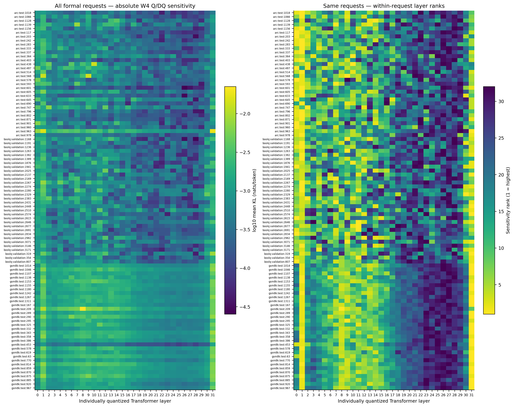
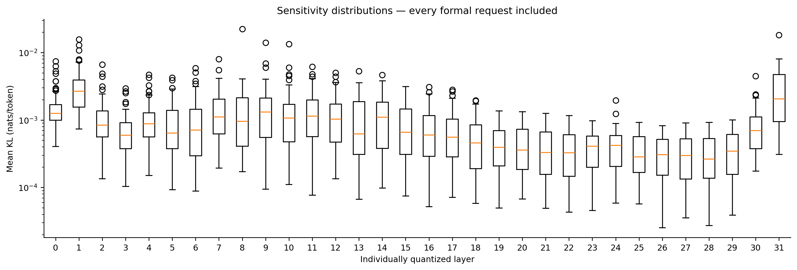
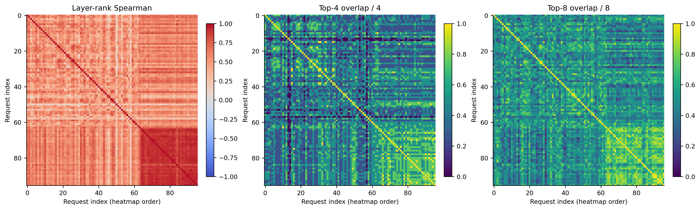
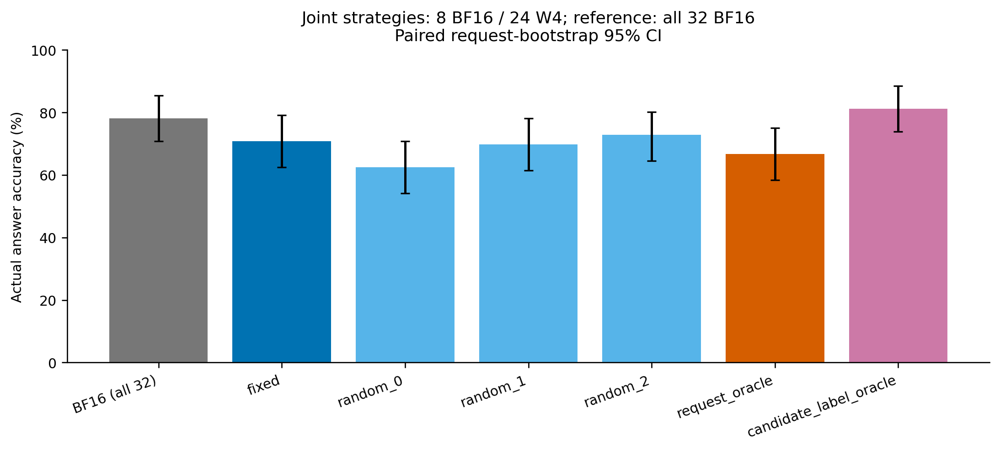

# Llama 3.1 8B individual-layer quantization sensitivity

Generated from validated **real model inference**: 96 formal requests × 32 individual layers = 3072 single-layer W4 measurements. Additionally 480 directly generated joint-allocation answers. No historical four-layer-group measurement is counted here.

Analysis status: primary W4 structure diagnostics resolved; scientific conclusions remain bounded below. A generated report or passing validator is not an automatic completion declaration.

## Research questions and evidence

1. **Request-dependent sensitivity and stability.** Different-request mean layer-rank Spearman: 0.5737 [0.54206, 0.60318]; rank heterogeneity (1 − correlation): 0.4263 [0.39682, 0.45794]. Content-half mean within-request Spearman: 0.83829 [0.81341, 0.86199] **among 32 eligible requests ({'gsm8k': 32}) only**. 462/496 layer pairs reverse by >1e-6 nats/token with at least two requests on each side across the formal cohort; 135/496 have both directions repeated across content halves in that eligible subset. Secondary different-request Spearman using content-only means: 0.51341 [0.47789, 0.54861]; using only the first continuation token: 0.46342 [0.4255, 0.50271]. Content-profile eligibility: 96/96 requests; empty content is omitted only from that secondary diagnostic, never primary outcomes. Reversals are descriptive, not 496 independent hypothesis tests. Stability claims apply only to eligible token traces, not every dataset. Content-only and first-token diagnostics overlap (they coincide for these BoolQ traces), so they are not independent replications or evidence of temporal/cross-wording stability.

2. **Higher-precision layer choice and actual utility.** Different-request Top-4 overlap fraction: 0.43783 [0.40692, 0.46948]; Top-8: 0.52223 [0.50291, 0.54063]. At the directly measured 8-layer BF16 budget, request-KL oracle minus train-selected fixed accuracy: **-4.1667 [-11.458, 3.125] percentage points**; versus the three-set random mean: -1.7361 [-7.2917, 3.4722] pp. The oracle has 5 gains and 9 losses versus fixed; its conservative stratified difference interval is [-28.71, 21.78] pp. A CI spanning zero is inconclusive: neither deployable improvement, equivalence, nor proof that request-adaptive allocation cannot help is established.

3. **Type, length, difficulty proxies.** Descriptive standardized-profile regression R²: 0.23018 [0.23464, 0.30471]. **Bracketed R² ranges in this paragraph are nominal in-sample refit/bootstrap ranges, not validated confidence bounds for heldout explanatory performance.** Partial R² for dataset: 0.024503 [0.02516, 0.064933], prompt length: 0.014131 [0.013907, 0.049058], BF16 output length: 0.0034781 [0.0030701, 0.016037], BF16 correctness proxy: 0.015587 [0.0074982, 0.04517]. Resampling/refitting optimism can shift these ranges upward and exclude the original point estimate; bias and coverage are unassessed. Positive partial-R² bounds are not evidence of an independent covariate effect. These are in-sample associations, not causal effects or independent difficulty labels. All layer coefficients, pointwise intervals, residuals, dataset-specific nonlinear-control diagnostics and length-quartile results are retained. The scalar log(mean KL) regression below uses the same controls; its coefficients are retrospective conditional associations.

| term | estimate_and_pointwise_interval |
| --- | --- |
| intercept | -7.2162 [-8.6217, -6.152] |
| dataset_boolq_vs_arc | 0.061349 [-1.6437, 2.3186] |
| dataset_gsm8k_vs_arc | 1.2327 [-0.57794, 3.372] |
| log_prompt_tokens_z | 0.022455 [-0.98637, 0.82987] |
| log_output_tokens_z | -0.26983 [-1.0266, 0.47272] |
| BF16_correct_difficulty_proxy | -0.35597 [-0.54227, -0.14293] |

## Method and data

Model: `meta-llama/Llama-3.1-8B` **base**, exact revision `d04e592bb4f6aa9cfee91e2e20afa771667e1d4b`. Tokenizer is from the same snapshot. The base checkpoint has no official chat template: the explicit fixed Q/A template in [chat_template.jinja](chat_template.jinja) is used consistently. Three train demonstrations per dataset; greedy deterministic decoding, no sampling, one beam, BF16 activation and KV cache. GSM8K max 256 new tokens, ARC/BoolQ 16; stop at EOS or the next Q delimiter. No sample is dropped for wrong answers, parser failures or truncation.

Every intervention changes exactly the seven attention/MLP linear weights of ONE of layers 0–31; the other 31 layers, embeddings, norms and head remain BF16. Symmetric RTN groupwise W4: group size 128 contiguous input features within output rows, FP32 absmax/7 scale, zero blocks scale 1, zero point 0, round-to-even codes [-7,7], no clipping, actual packed-nibble round-trip, dequantized BF16 forward. **Quantization sensitivity simulation only**: no W4 kernel, speedup or memory-saving claim. Quantization MSE/code digests, exact parameter isolation/restoration and actual precision probes are saved.

`KL(P_BF16 || P_W4)` uses the same fixed BF16 greedy continuation for every layer of a request, identical full-sequence teacher-forcing path and causal shift. Full vocabulary log probabilities in FP32, sum in FP64; mean per target token in nats. Stop tokens remain in the primary full trace. Secondary content-only metrics exclude special/whitespace/next-question tokens. Numerical replay discrepancy in the required gates is zero. Independently generated answers, not teacher-forced labels, determine accuracy.

Pinned GSM8K test, ARC-Challenge test, BoolQ validation samples: **8 smoke + 32 formal each**; train-only selection **8 each** and demonstrations **3 each**. Dataset revisions, source parquet SHA256, sampling seed 20261015 and excluded duplicates are in [data_manifest.json](data_manifest.json). [requests.jsonl](requests.jsonl) records every source ID, raw question, split and gold; baseline JSON/CSV records the entire rendered prompt and token IDs. Smoke and formal are disjoint; all roles are deduplicated by normalized question. No quantizer calibration data is needed.

Scoring is frozen: GSM8K final `####` marker, entire first line must be an integer/decimal (valid thousands commas and optional terminal punctuation); unsupported fractions/exponents/units are parse failures. ARC requires a leading valid option label, BoolQ a leading yes/no word. Parsers are unit tested and raw generated texts/token IDs are retained for independent examination.

## Direct precision allocation check

Fixed high-precision layers: **[0, 1, 8, 9, 10, 11, 13, 31]**, selected by highest train-only mean KL and frozen at `2026-10-15T20:17:12.884769+00:00` before formal inference. Every strategy retains exactly 8 BF16 layers and jointly quantizes the other 24. The `request_oracle` uses that evaluation request's full individual-layer KL vector: an expensive oracle-information benchmark, **not a learned/deployable router, and not a guaranteed accuracy upper bound**. The separately reported `candidate_label_oracle` chooses a correct answer among the five *actually measured* joint configurations and is only a finite-candidate, label-using upper bound. Its measured accuracy is **81.25 [73.958, 88.542]%**; it neither searches every possible eight-layer set nor demonstrates a deployable selector.

| dataset | requests | BF16_percent | fixed_percent | request_KL_oracle_percent | random_mean_percent |
| --- | --- | --- | --- | --- | --- |
| all | 96 | 78.125 [70.833, 85.417] | 70.833 [62.5, 79.167] | 66.667 [58.333, 75] | 68.403 [61.102, 75.694] |
| arc | 32 | 87.5 [75, 96.875] | 84.375 [71.875, 96.875] | 87.5 [75, 96.875] | 83.333 [68.75, 94.792] |
| boolq | 32 | 93.75 [84.375, 100] | 84.375 [71.875, 96.875] | 78.125 [62.5, 90.625] | 81.25 [69.792, 90.625] |
| gsm8k | 32 | 53.125 [37.5, 68.828] | 43.75 [28.125, 62.5] | 34.375 [18.75, 50] | 40.625 [26.042, 56.25] |

Random sets (conditional request-bootstrap inference, not uncertainty over all possible random sets):

| strategy | BF16_layers | accuracy_percent |
| --- | --- | --- |
| random_0 | [8, 11, 15, 17, 18, 23, 27, 31] | 62.5 [54.167, 70.833] |
| random_1 | [1, 14, 20, 21, 24, 27, 28, 31] | 69.792 [61.458, 78.125] |
| random_2 | [1, 10, 16, 17, 21, 22, 23, 26] | 72.917 [64.583, 80.208] |

Joint KL is directly measured too: [precision_allocation_check/measurements.csv](precision_allocation_check/measurements.csv) includes joint KL and the sum of constituent individual-layer KLs. Their ratio measures nonadditivity, not a prediction of accuracy. Request-oracle mean joint/additive ratio: 0.9743 [0.82085, 1.1741].

## Statistical uncertainty and all-request diagnostics

2000 paired, dataset-stratified request bootstrap replicates, seed 20261015, percentile 95% intervals. All 32 layer rows and all 5 configurations for one source remain paired; neither layer rows nor the 4,560 request pairs are treated as independent observations. Repeated bootstrap copies of the same source are excluded from different-request pairs. Random sets and train-selected fixed set are conditioned upon; selection-data uncertainty is not included. Per-layer/coefficient intervals are pointwise and descriptive, not simultaneous tests. R²/partial-R² entries are the explicitly qualified nominal refit ranges above; the `interval_interpretation` column in statistics.csv distinguishes them. Bootstrap accuracy intervals can collapse when no discordance is observed; this does not establish zero population risk. [Exact binomial accuracy intervals](analysis/exact_accuracy_intervals.csv) and [conservative paired difference intervals](analysis/conservative_paired_accuracy_intervals.csv) are therefore also reported. The latter combine two Clopper–Pearson intervals for gain/loss probabilities by a union bound. Within one dataset these are two 97.5% intervals; for the combined three-dataset result, Bonferroni allocation across all six component probabilities and weighted aggregation respects the fixed dataset strata. This is conservative and does not assume independent paired answers or a common accuracy across datasets.

Control response: per-request centered/unit-SD 32-layer profile; intercept, dataset indicators (ARC reference), standardized log prompt/output tokens and BF16 correctness. Output length/correctness are post-model variables; adjustments do not establish causality. The protocol-required secondary fit uses dataset-specific cubic log prompt **and cubic log output** (separate powers 1–3, dataset intercepts). The initially implemented cubic-prompt/linear-output fit is also retained, not silently replaced. See [cubic-output residuals](analysis/cubic_prompt_output_profile_residuals.csv), [its minimum-norm coefficients](analysis/cubic_prompt_output_coefficients.csv), and [the earlier diagnostic](analysis/nonlinear_controlled_profile_residuals.csv). Primary linear rank 6/6, max leverage 0.20514; cubic-prompt/linear-output rank 14/15, max leverage 1; cubic-both-lengths rank 16/21, max leverage 1. Effectively interpolated cubic-both-lengths requests: ['arc:test:963']. Rank deficiency makes individual polynomial coefficients nonidentifiable; unit leverage means a row is interpolated. Lower in-sample residual RMS is not better generalization or proof of nuisance-independent structure. All rows and both nonlinear fits remain available; no preferred control model is chosen from favorable results.

| dataset | segment | eligible |
| --- | --- | --- |
| arc | content | 0 |
| arc | full | 32 |
| boolq | content | 0 |
| boolq | full | 32 |
| gsm8k | content | 32 |
| gsm8k | full | 32 |

Insufficient content traces are explicitly ineligible, not assigned perfect stability. Full-trace halves may include delimiters, so they cannot alone establish within-answer stability for ARC/BoolQ. See [analysis/segment_stability.csv](analysis/segment_stability.csv) and [analysis/length_quartiles.csv](analysis/length_quartiles.csv).

## Figures (all formal requests)









Each figure also has a vector PDF in `figures/`. Row order is dataset/source ID, not selected by sensitivity.

## Failures, null cases and limitations

| configuration | answers | incorrect | parse_failures | truncated |
| --- | --- | --- | --- | --- |
| BF16 | 96 | 21 | 3 | 2 |
| joint_W4 | 480 | 151 | 10 | 6 |
| single_layer_W4 | 3072 | 719 | 81 | 52 |

[analysis/answers.csv](analysis/answers.csv) includes every BF16, single-layer and joint answer; [analysis/answer_failures.csv](analysis/answer_failures.csv) includes all incorrect or unparseable/truncated answers, not a curated subset. [analysis/request_summary.csv](analysis/request_summary.csv) flags requests whose correctness never changes and those where allocation oracle does not beat fixed. Both gains and losses are retained.

Limits: one base checkpoint/revision/template, one wording per source, small fixed benchmark subsets, greedy decoding, fixed output caps, possible pretrained benchmark contamination, no independent annotated difficulty, no real integer kernels. The deterministic sample IDs were also used in the historical grouped study; this is a newly specified individual-layer measurement, not an unseen-to-investigator dataset replication. No source was selected or removed based on favorable layer results. A sensitivity rank is about probability distributions, not necessarily correctness. Combined quantization has interactions and the oracle-information heuristic is not guaranteed optimal. Wide intervals and null results must not be rephrased as proven gains or absence of effects. No clustering, router or production batching is implemented.

Predeclared escalation decision: `{'required': False, 'reasons': [], 'numerical_replay_discrepancy': 0, 'preserve_original_96': True, 'extensions_are_exploratory': True}`. If triggered, first audit quantization/KL/parser, then extend the deterministic prefix to 64/dataset and inspect all length strata, then only if needed consider W3 with a recorded addendum. Keep original W4 results and mark outcome-triggered extensions exploratory with nominal, non-sequentially-adjusted intervals.

Next verifiable question: does the observed individual-layer ordering persist on a larger disjoint, length-stratified heldout prefix, and do the directly measured joint-allocation accuracy differences narrow enough to distinguish benefit from loss? This report does not propose a production router.

## Reproduction and evidence

Hardware recorded in [runs/evaluation/attempt_0.json](runs/evaluation/attempt_0.json): `NVIDIA GeForce RTX 3090`, CUDA `12.8`, PyTorch `2.8.0+cu128`, Transformers `4.56.1`; BF16 single-request execution. Use a BF16-capable ~24 GiB GPU and ≥40 GiB available host RAM for the two CPU allocation weight copies, plus model cache/results storage.

```bash
bash scripts/install.sh
.venv/bin/python -m pytest -q tests
LAYER_GPU=<allocated_gpu> bash scripts/run_layer_sensitivity.sh smoke
LAYER_GPU=<allocated_gpu> bash scripts/run_layer_sensitivity.sh full
bash scripts/run_layer_sensitivity.sh report
```

Use `LAYER_OUT=results/layer_sensitivity_reproduction` for a fresh independent campaign. The default full command resumes only source/input-identical inference and revalidates reused records. The report command is CPU-only and preserves previous derived output. Actual commands, start/end timestamps, CUDA visibility, logs and exit codes are in [steps/](steps/). Do not infer execution success merely from the above command examples.

Canonical outputs: [runs/evaluation/measurements.csv](runs/evaluation/measurements.csv), matching Parquet, [32-value vectors](runs/evaluation/sensitivity_vectors.csv), per-request JSON and BF16 reference logits retained locally; [analysis/statistics.csv](analysis/statistics.csv), [all layer-pair reversals](analysis/ranking_reversals.csv), [request pairs](analysis/request_pairs.csv), [analysis/metadata.json](analysis/metadata.json). The original prompt-to-artifact completion audit is [../../doc/layer_sensitivity_completion_audit.md](../../doc/layer_sensitivity_completion_audit.md).
