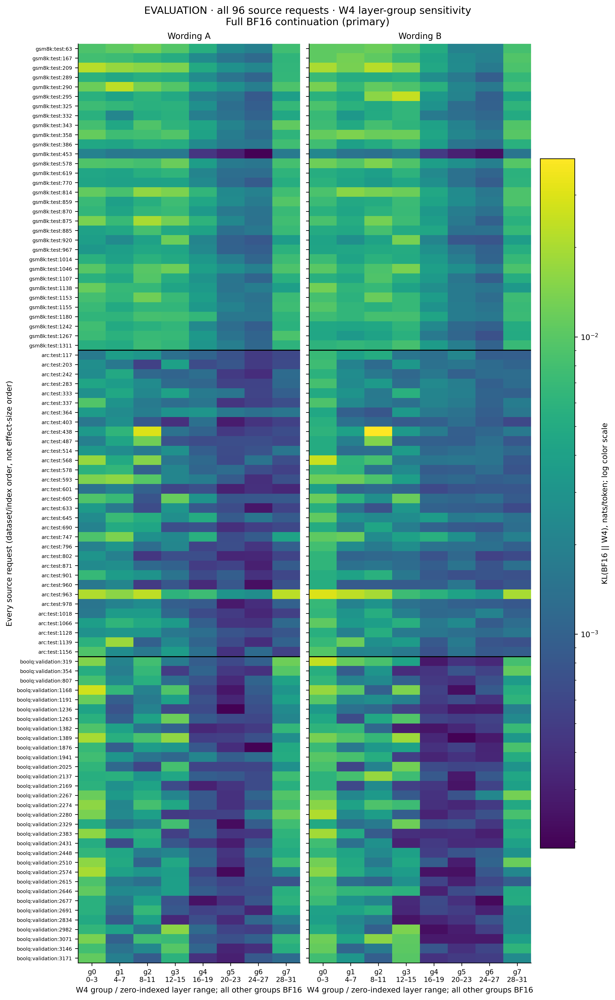
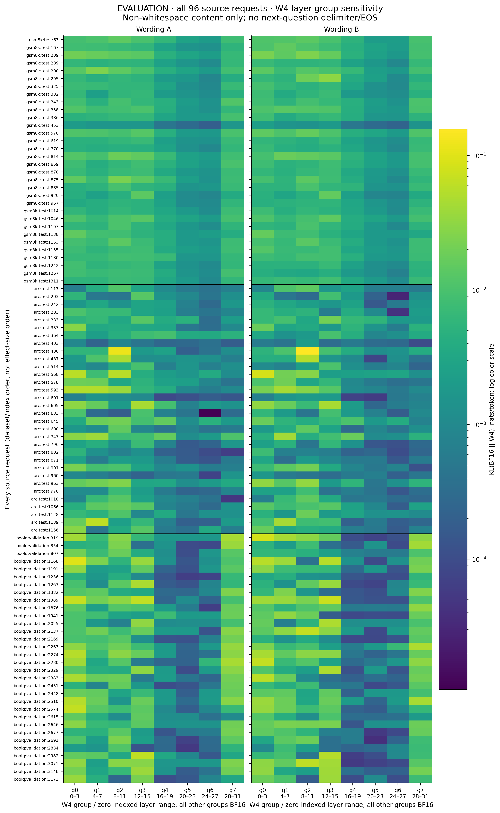
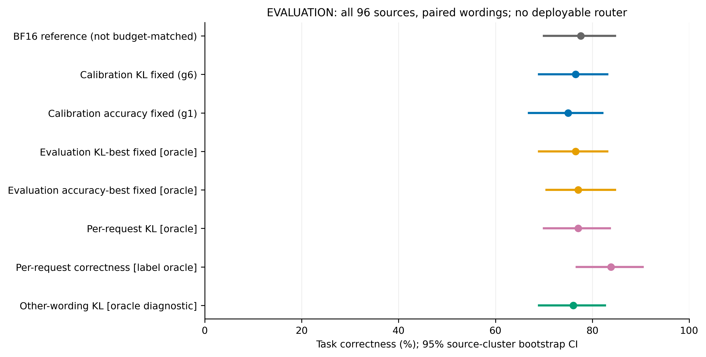

# M1 — Llama 3.1 8B request-dependent layer quantization sensitivity

## 結論與範圍

**證據支持一個有限的 M1 結論：在本模型、RTN W4、四層一組與固定 few-shot protocol 下，不同 request 對不同 group 的相對敏感度與實際答案效用存在可重現差異。**
這**不是**可部署 router、跨 wording 最佳配置可直接轉移、完整模型 W4 品質、或量化 runtime 效能的證據。

- 正式資料：**96 個獨立 source request**（每 dataset 32），兩種 wording 共 192 個 prompt；**1536 筆 W4 配置量測、1728 筆實際答案、62,240 個 token-level KL 值**。未依效果或正確率剔除 request。
- 全 continuation 與非空白 content-only 分析，各有 22/28、23/28 個 group pair 出現**兩種 wording 都重現**的跨 request 排序反轉；實際 correctness 有 **19/28** 個 pair 的雙向 crossover 也在兩種 wording 重現。
- 相同 precision budget，label oracle 相對 accuracy-best evaluation-fixed oracle 的改善：**6.77 pp [2.60, 9.38]**。這是使用 evaluation labels 的 **oracle upper bound**，不能當作部署收益。
- 跨 wording 轉移檢查：用另一種 wording 的 KL 最佳組來選配置，full KL 相對 best fixed 的改善為 **0.12% [-5.04, 4.95]**。**CI 包含零；穩定的整體排名不代表 argmin 可穩定轉移。**

## 實驗 protocol、來源與硬體

- 模型：`meta-llama/Llama-3.1-8B@d04e592bb4f6aa9cfee91e2e20afa771667e1d4b`，**base 而非 Instruct**。四個真實 safetensors shards 與 tokenizer/config 的官方 digest 全部匹配：[model_provenance.json](model_provenance.json)。
- Base tokenizer 沒有官方 chat template；使用明確保存的三個 train-only demonstration 的 plain-text Q/A template：[chat_template.jinja](chat_template.jinja)。每個 precision configuration 使用相同 tokenizer、template、prompt IDs。兩種 wording 僅改預定的指令說法，並非題目本體的任意 paraphrase。
- Reference/線性層 input-output/BF16 decode KV cache 均為 BF16；保留標準 Llama 內部 norm/softmax 行為。KL 用相同 full-sequence teacher-forcing、`use_cache=False` 路徑；實際答案用新建 BF16 KV cache 的 greedy generation。
- 32 層分 g0=0–3、g1=4–7、…、g7=28–31。每次只有一組的 attention/MLP 七個 linear weight/層量化；其他組、norm、embedding、LM head 保留 BF16。每組 28 個矩陣、**872,415,232 個量化 weight**，所以所有八種候選配置的 precision budget 相同。BF16 reference 不在 budget-matched oracle 的 action set。
- W4：per-output-row、沿 input dimension 每 128 個 weight 一個 block；FP32 absmax/7 scale，ties-to-even RTN，signed [-7,7]，零 block scale=1；不做 activation-aware calibration、clipping tuning 或 per-request quantizer tuning。實際產生 packed 4-bit codes 並 round-trip decode，將其反量化為 BF16 執行模型（Q/DQ）。**這量測真實量化後權重的誤差，不是 packed-integer kernel 的速度/記憶體測試。**
- Seed **20261015**；GSM8K/ARC-Challenge 使用 test，BoolQ 使用 validation。每種資料 train 中抽 3 demos + 8 獨立 calibration；held-out split 中先抽 8 smoke，再抽 32 disjoint evaluation。問題 hash 去重，完整 IDs/文字/gold： [requests.jsonl](requests.jsonl)、[data_manifest.json](data_manifest.json)。RTN 本身不需 calibration；calibration 僅用來選固定組。
- 正式 inference 前（2026-10-15T15:33:22.710943+00:00）封存：KL-fixed **g6**、accuracy-fixed **g1**；同分取最小 group index。證據：[calibration_selection.json](calibration_selection.json)。
- Torch 2.8.0+cu128 / Transformers 4.56.1；NVIDIA GeForce RTX 3090，CUDA runtime 12.8。正式 A/B 的最後 attempt 分別用 physical GPU `1` / `2`。逐 attempt 的 driver、硬體、套件、參數與 code hashes 在 `runs/*/attempt_*.json`、`run_config.json`。
- Dataset revisions：`openai/gsm8k@740312add88f781978c0658806c59bc2815b9866` (main/test); `allenai/ai2_arc@210d026faf9955653af8916fad021475a3f00453` (ARC-Challenge/test); `google/boolq@35b264d03638db9f4ce671b711558bf7ff0f80d5` (data/validation)
- Greedy、不 sampling；GSM8K 最多 256 new tokens，ARC/BoolQ 16。GSM8K 嚴格解析 `#### <number>`（Decimal 比較）；ARC 解析有效選項標籤；BoolQ 解析 yes/no。解析失敗算錯，truncation 保留，不排除。

## 量測正確性與統計方法

- KL 方向為 **KL(p_BF16 || p_W4)**，全 vocabulary；FP32 log-softmax/product、FP64 summation。每個 group 在同一 BF16 continuation 的同一 history 上 teacher-force；token t 對應 P+t−1 的 causal logit。W4 的實際答案另外自由 greedy 生成，不能把不同 history 的 logits 當成 KL。
- 原始 primary trace 包含回傳的 EOS/next-question delimiter。次要 content-only 分析一致排除 special、standalone whitespace 與 `Q:` delimiter；不依 label 或效果選 token。Whole token 跨 delimiter 者排除；無 delimiter 的混合文字/尾端空白 token 保留。首個 generated token 可能只是 ARC 數字前的空白，因此 first-token 是格式敏感診斷，不一律等同答案 token。
- 獨立 BF16/W4 same-path replay、逐組 restore logits 及完整選定 weight restore 均 exact；單組完整 parameter digest 證明只改 28 個指定矩陣。這是已檢查路徑的 floor，不是所有硬體/演算法的通用 noise 保證。原始額外 gate 中 GPU 1/2 也 bitwise 重現 GPU 5；見 `steps/cross_gpu{1,2}/cross_device_comparison.json`。
- Cached replay 與 full teacher forcing 在 gate request 的 KL 為 **0.000370752 nats/token**；full-route g0 W4 KL 為 0.00651636。所有 primary 比較都使用同一路徑。尤其 oracle gain 可以小於這個跨路徑 discrepancy，**不能據此保證 cached runtime 的最優 KL 配置**；實際答案/correctness crossover 是獨立的 cached-generation 證據。
- **2000 次、95% percentile bootstrap**；在 dataset 內重抽 source requests，兩種 wording、全部 groups 共同保留。每次重選 evaluation-best fixed；品質差異使用配對差值，而非看兩個獨立 CI 是否重疊。CIs 條件於固定 demos/calibration，不涵蓋重新抽 calibration 的不確定性。
- 排序反轉忽略差異 <= max(1e−5 nats/token, pair mean 的 1%, 5×已測 replay discrepancy)。報告全部 28 pairs，不對個別 pair 做挑選式 significance test。
- 主 robustness 控制對每個 request 的 group profile 做 row centering/standardization，去除固定 profile 的任意正 affine magnitude；使用 dataset-specific cubic log input length，並另加 dataset-specific log BF16 output length。報告 source-bootstrap residual correlation CI 與 nuisance-projected HC2 source-cluster wild-score 的 **approximate** p-value；16 個 test 做 Holm adjustment。這不是精確 randomization/因果識別；指定的長度模型不能排除任意非線性長度效應或其他未知 confound。
- 原本 coarse-bin residual permutation 沒有嚴格 exchangeability 保證，僅保留為 exploratory diagnostic：[controlled_interaction.csv](analysis/controlled_interaction.csv)，不拿它作確認性證據。修正經獨立 read-only review。
- **方法驗證的合成資料不是模型實驗結果**：八個預定 null scenario（n=32/96，每個 500 trials、999 multipliers）拒絕率 0.044–0.060，兩個 strong positive control 為 500/500、500/500；見 [statistical_null_calibration.json](steps/statistical_null_calibration.json)。此結果支持但不證明普遍校準；部分 binomial CI upper bound >0.08，亦未證明較小 Holm 門檻的精確 error rate。

## 完整 evaluation set 的敏感度與穩定性

以下列出全體計數；完整逐 request/group 數據及每 token KL：[per_request_measurements.csv](analysis/per_request_measurements.csv)。

### 最高敏感組（full KL）

| dataset | wording | g0 | g1 | g2 | g3 | g4 | g5 | g6 | g7 |
|---|---|---|---|---|---|---|---|---|---|
| gsm8k | a | 8 | 1 | 9 | 4 | 0 | 0 | 0 | 10 |
| gsm8k | b | 9 | 3 | 8 | 8 | 0 | 0 | 0 | 4 |
| arc | a | 9 | 16 | 5 | 2 | 0 | 0 | 0 | 0 |
| arc | b | 25 | 3 | 3 | 1 | 0 | 0 | 0 | 0 |
| boolq | a | 22 | 0 | 1 | 5 | 0 | 0 | 0 | 4 |
| boolq | b | 19 | 0 | 3 | 6 | 0 | 0 | 0 | 4 |

### 最低敏感組（full KL）

| dataset | wording | g0 | g1 | g2 | g3 | g4 | g5 | g6 | g7 |
|---|---|---|---|---|---|---|---|---|---|
| gsm8k | a | 0 | 0 | 0 | 0 | 0 | 3 | 29 | 0 |
| gsm8k | b | 0 | 0 | 0 | 0 | 0 | 2 | 30 | 0 |
| arc | a | 0 | 0 | 1 | 0 | 0 | 12 | 16 | 3 |
| arc | b | 0 | 0 | 1 | 0 | 2 | 3 | 12 | 14 |
| boolq | a | 0 | 0 | 0 | 2 | 4 | 20 | 6 | 0 |
| boolq | b | 0 | 1 | 0 | 3 | 9 | 12 | 7 | 0 |

全 ranking 的跨 wording Spearman：**0.8326 [0.8095, 0.8549]**；最高組 agreement 54.17% [43.75, 64.58]，最低組 agreement 54.17% [45.83, 62.50]。

| dataset | full replicated pair reversals /28 | content replicated pair reversals /28 |
|---|---|---|
| all | 22 | 23 |
| gsm8k | 11 | 11 |
| arc | 18 | 21 |
| boolq | 16 | 14 |

全部方向計數與 near ties：[ranking_reversals.csv](analysis/ranking_reversals.csv)；actual correctness 的全部 pair 表：[correctness_crossovers.csv](analysis/correctness_crossovers.csv)。這些 pair 數不是獨立樣本數。

### 控制 dataset 與長度後

| metric | scope | shape residual correlation [95% CI] | approx. wild p (Holm) |
|---|---|---|---|
| full | all | 0.6539 [0.5585, 0.7304] | 0.007996 |
| full | gsm8k | 0.6275 [0.3888, 0.7947] | 0.007996 |
| full | arc | 0.6177 [0.4582, 0.7405] | 0.007996 |
| full | boolq | 0.7140 [0.5725, 0.8211] | 0.007996 |
| content | all | 0.7058 [0.6217, 0.7792] | 0.007996 |
| content | gsm8k | 0.6250 [0.3811, 0.7962] | 0.007996 |
| content | arc | 0.7469 [0.6207, 0.8620] | 0.007996 |
| content | boolq | 0.6932 [0.5491, 0.7978] | 0.007996 |

表中是同時控制 input/output length 的版本；input-only 版本及所有 leverage/CI：[controlled_shape_wild.csv](analysis/controlled_shape_wild.csv)。原始 p 的 Monte Carlo 最小可解析值是 1/2001；不得寫成 p=0。

### 評估片段

| 片段 | scope | 有效 source / worded requests | 半段 ranking Spearman [95% CI] | 四路 replicated reversals /28 |
|---|---|---|---|---|
| full | all | 96 / 192 | 0.5221 [0.4859, 0.5625] | 16 |
| full | gsm8k | 32 / 64 | 0.7965 [0.7649, 0.8281] | 9 |
| full | arc | 32 / 64 | 0.2954 [0.2239, 0.3665] | 4 |
| full | boolq | 32 / 64 | 0.4743 [0.3888, 0.5592] | 3 |
| content | all | 32 / 64 | 0.7920 [0.7545, 0.8311] | 9 |
| content | gsm8k | 32 / 64 | 0.7920 [0.7545, 0.8311] | 9 |

四路表示兩種 wording × first/second half 的同方向跨 request 反轉。**ARC/BoolQ 只有單一非空白答案 content token，無法估計 content 半段穩定性**；不得把 delimiter 的穩定當成語義答案穩定。Content-only 半段有效 source 僅 GSM8K 32（64 worded）。完整 denominators 包含不可估計項：[segment_stability.csv](analysis/segment_stability.csv)。

**高 leverage 限制與事後影響度診斷：**原始 nuisance fits 的最大 leverage 為 0.999999999（約 1；見完整 CSV），因此小樣本 wild inference 特別需要保留限制。獨立審查後，事後影響度檢查用單次規則『任一 wording leverage ≥ 0.95』只在診斷副本中排除 2 個 sources、重新擬合；content/output-adjusted correlation 從 0.705757 變為 0.705178（診斷 n=94）。主分析仍保留全部 96 sources，所有原 CI/p 不改。這只檢查點估計影響度，**不是**高-leverage p-value 校準的證明或新的確認性分析。所有模型/排除 ID：[leverage_influence.json](steps/leverage_influence.json)。

## 相同 precision budget 與實際答案品質

| 選擇方式 | 實際 correct /192 | accuracy % [95% CI] | full KL nats/token [95% CI] |
|---|---|---|---|
| BF16 reference (非同 budget) | 149 | 77.60 [69.79, 84.90] | reference |
| Calibration KL fixed g6 | 147 | 76.56 [68.75, 83.33] | 0.000976 [0.000900, 0.001055] |
| Calibration accuracy fixed g1 | 144 | 75.00 [66.67, 82.29] | 0.004737 [0.004096, 0.005473] |
| Evaluation KL-best fixed — ORACLE | 147 | 76.56 [68.75, 83.33] | 0.000976 [0.000900, 0.001055] |
| Evaluation accuracy-best fixed — ORACLE | 148 | 77.08 [70.31, 84.90] | 0.001106 [0.000945, 0.008002] |
| Per-request KL — BF16-reference ORACLE | 148 | 77.08 [69.79, 83.85] | 0.000815 [0.000753, 0.000887] |
| Per-request correctness — LABEL ORACLE | 161 | 83.85 [76.56, 90.62] | 0.007688 [0.006803, 0.008659] |
| Other-wording KL — ORACLE diagnostic | 146 | 76.04 [68.74, 82.81] | 0.000975 [0.000901, 0.001053] |

所有 oracle 都要事先看到 evaluation 的 BF16 distributions 或 labels/全部配置結果；**沒有實作或證明可部署 request router**。各 dataset 表內的 evaluation-best fixed 另在該 dataset 範圍取最佳，因此比單一全域固定組更有利。

| dataset | BF16 % [95% CI] | accuracy-best fixed oracle % | label oracle % | paired oracle gain pp [95% CI] |
|---|---|---|---|---|
| gsm8k | 51.56 [35.94, 67.19] | 51.56 [39.06, 68.75] | 70.31 [54.69, 84.38] | 18.75 [6.25, 26.56] |
| arc | 87.50 [75.00, 96.88] | 87.50 [75.00, 96.88] | 87.50 [75.00, 96.88] | 0.00 [0.00, 0.00] |
| boolq | 93.75 [84.38, 100.00] | 93.75 [84.38, 100.00] | 93.75 [84.38, 100.00] | 0.00 [0.00, 0.00] |

| 配對比較 | full [95% CI] | content-only [95% CI] |
|---|---|---|
| KL oracle vs KL-best fixed: absolute nats/token | 0.000160 [0.000121, 0.000201] | 0.000377 [0.000251, 0.000456] |
| KL oracle vs KL-best fixed: relative reduction % | 16.45 [12.69, 19.98] | 34.37 [25.80, 38.91] |
| Other-wording KL selection: relative reduction % | 0.12 [-5.04, 4.95] | 6.62 [-8.16, 15.87] |
| KL oracle accuracy vs BF16: pp (非同 budget) | -0.52 [-2.60, 2.08] | -0.52 [-2.60, 2.08] |

Label oracle 對最佳固定 accuracy 的 13 個額外 worded correct 中，**12 個比較的兩個配置都未 truncation**；1 個涉及 truncation。這是全樣本的描述性分解，不是排除截斷案例後重新宣稱效果。KL oracle 的代數最小值改善本身不足以證明命題；此處同時檢查 replicated reversals、controlled shape 和真實答案 crossover。

所有 1,728 個實際答案、token IDs、gold、correctness：[answers.csv](analysis/answers.csv)；每個 oracle 的實際選擇/答案：[oracle_comparisons.csv](analysis/oracle_comparisons.csv)。

## 失敗、無改善與限制（不移除）

- **149/192** worded requests 在八種 W4 下 correctness 全相同；**104/192** 對 calibration KL-fixed 沒有超過 near-tie 門檻的 KL oracle 改善。完整名單：[no_benefit_or_loss_cases.csv](analysis/no_benefit_or_loss_cases.csv)。
- 437/1728 個實際答案錯誤；26 parse failures、26 truncated outputs 全保留。完整原文：[answer_failures.csv](analysis/answer_failures.csv)。
- Label oracle 的 task-quality gain 以 **gsm8k** 最大；相對各自最佳固定配置的 point gain 為 0 的 dataset：**arc, boolq**。不能把整體平均改善宣稱為每個 dataset 都改善。
- KL oracle 相對 BF16 的配對 accuracy 差為 -0.52 pp [-2.60, 2.08]；跨 wording KL choice 相對 accuracy-best fixed 為 -1.04 pp [-4.18, 0.00]。較低 KL 不必然代表更高答案正確率。
- 不做部署、泛化到其他 model/quantizer、全模型 W4、吞吐/壓縮率的宣稱。只有一個固定 seed、每 dataset 32 個獨立 source、固定三個 demos 和小 calibration set，CI 不包含全部設計選擇/模型 pretraining contamination 的不確定性。
- 這個結果足以顯示指定 W4 條件下的 request×group 差異與有限 oracle 潛力，不足以證明可以預測/轉移最佳配置。沒有為取得更好數字升級 W3 或挑樣本；所有原始 W4、pilot、失敗與方法修正均保留。

## 圖與完整產物

- 圖也提供 PDF，另有 [row-normalized heatmap](sensitivity_heatmap_normalized.png)。顏色使用 log scale/floor 1e−8 僅為顯示；原始數值與統計未裁切。所有 source 都依 dataset/source index 顯示，不依效果排序。
- 全部 CI：[statistics.csv](analysis/statistics.csv)；逐 request 摘要：[request_summary.csv](analysis/request_summary.csv)；輸入/分析 code hashes：[analysis_metadata.json](analysis/analysis_metadata.json)。
- 原始量測：`runs/evaluation_{a,b}/{baselines.csv,measurements.csv}`、每 group JSON；`reference_logits/*.pt` 本機保留但 Git-ignored。Smoke/calibration raw records 在同目錄對應 role。

## 實際執行紀錄與可重現命令

安裝：`bash scripts/install.sh`；unit tests：`.venv/bin/python -m pytest -q tests`。一鍵 M1：`M1_GPU=1 bash scripts/run_m1.sh`（選自己的可用 GPU；既有 raw checkpoints 會驗證/續跑，不重做已完成 inference）。完整新推論重現可指定 `M1_OUT=results/m1_reproduction M1_GPU=1 bash scripts/run_m1.sh`。

| 步驟 | command 摘要（實際 argv 見 metadata/ledger） | exit code / log |
|---|---|---|
| locked install | bash scripts/install.sh | 0 / [log](steps/install-locked.log) |
| unit tests + inferential fixes | .venv/bin/python -m pytest -q tests | 0 / [log](steps/review-fix-tests.log) |
| real BF16 baseline | CUDA_VISIBLE_DEVICES=5 <qaq-gptq425>/bin/python -m scripts.baseline | 0 / [log](steps/baseline.log) |
| one-group intervention | CUDA_VISIBLE_DEVICES=5 <qaq-gptq425>/bin/python -m scripts.one_group | 0 / [log](steps/one_group.log) |
| same-path KL / repeat | CUDA_VISIBLE_DEVICES=5 .venv/bin/python -m scripts.sensitivity --groups 0 --repeat-check | 0 / [log](steps/single_sensitivity.log) |
| 8-group gate | CUDA_VISIBLE_DEVICES=5 .venv/bin/python -m scripts.sensitivity --groups 0 1 2 3 4 5 6 7 --out results/m1/steps/eight_groups | 0 / [log](steps/eight_groups.log) |
| smoke a | .venv/bin/python -m m1_run --role smoke --wording a --out results/m1/runs/smoke_a | 0 / [log](steps/smoke_a.log) |
| smoke b | .venv/bin/python -m m1_run --role smoke --wording b --out results/m1/runs/smoke_b | 0 / [log](steps/smoke_b.log) |
| smoke raw audit | .venv/bin/python -m scripts.validate_runs --role smoke --runs results/m1/runs/smoke_a results/m1/runs/smoke_b --out results/m1/smoke_validation.json | 0 / [log](steps/validate-smoke.log) |
| calibration a | .venv/bin/python -m m1_run --role calibration --wording a --out results/m1/runs/calibration_a | 0 / [log](steps/calibration_a.log) |
| calibration b | .venv/bin/python -m m1_run --role calibration --wording b --out results/m1/runs/calibration_b | 0 / [log](steps/calibration_b.log) |
| calibration raw audit | .venv/bin/python -m scripts.validate_runs --role calibration --runs results/m1/runs/calibration_a results/m1/runs/calibration_b --out results/m1/calibration_validation.json | 0 / [log](steps/validate-calibration.log) |
| evaluation a | .venv/bin/python -m m1_run --role evaluation --wording a --out results/m1/runs/evaluation_a | 0 / [log](steps/evaluation_a.log) |
| evaluation b | .venv/bin/python -m m1_run --role evaluation --wording b --out results/m1/runs/evaluation_b | 0 / [log](steps/evaluation_b.log) |
| evaluation raw audit | .venv/bin/python -m scripts.validate_runs --role evaluation --runs results/m1/runs/evaluation_a results/m1/runs/evaluation_b --out results/m1/evaluation_validation.json | 0 / [log](steps/validate-evaluation.log) |
| fixed choices | .venv/bin/python -m scripts.select_fixed | 0 / [log](steps/select-fixed.log) |
| synthetic method calibration ONLY | OPENBLAS_NUM_THREADS=1 OMP_NUM_THREADS=1 .venv/bin/python -m scripts.calibrate_statistics | 0 / [log](steps/statistical-null-calibration-reviewed.log) |
| formal analysis | OPENBLAS_NUM_THREADS=1 OMP_NUM_THREADS=1 .venv/bin/python -m scripts.analyze_m1 | 0 / [log](steps/analyze-evaluation.log) |
| formal figures | .venv/bin/python -m scripts.plot_m1 | 0 / [log](steps/plot-evaluation.log) |
| one-command resume + re-analysis | M1_GPU=1 bash scripts/run_m1.sh | 0 / [log](steps/one-click.log) |

初期 baseline/one-group 用既有 `/nfs/home/s314511048/.venvs/qaq-gptq425`（相同 Torch/Transformers）；之後使用本專案 locked `.venv`，並 exact 重現 baseline。首次套件下載超過 tool 600 秒 timeout（沒有捏造 exit code），背景重試與 locked install 成功。Smoke-B 因 GPU 共用遷移而主動中斷一次 **exit 143**，續跑完成 exit 0；原 log 保留。

一鍵命令逐步 `.command/.log/.exit` 的完整 ledger 路徑：[last_one_click_run.txt](last_one_click_run.txt)。此次一鍵驗證使用既有真實 raw checkpoints 並重新跑 provenance、unit tests、raw audit、統計與圖/報告；未聲稱又做一次全新 GPU inference。原分析/報告已備份到該 ledger。
這份報告不以 tests/manifest 的綠燈代替研究結論。逐條 objective→artifact 的完成審核見 repository 的 `doc/completion-audit.md`；執行歷程與原始審查在 `WORK_LOG.md`、`doc/`。
